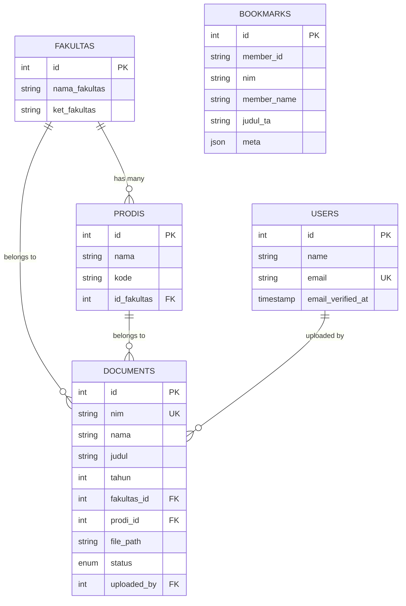

# 📋 Dokumen Arsitektur Teknis - SIBASIS/ABATA

**Sistem Informasi Basis Skripsi** - Platform manajemen dan pencarian dokumen tugas akhir untuk mahasiswa dan administrator.

---

## 1. 🔧 Tech Stack

### Backend Framework
- **Laravel 12** (Framework PHP terbaru)
- **PHP ^8.2** (Minimum requirement)

### Frontend Stack
- **Vite 7** — Build tool modern (menggantikan Webpack)
- **TailwindCSS 4** — Utility-first CSS framework
- **Bootstrap 5** — Component library dengan Bootstrap Icons
- **SASS** — CSS preprocessing
- **Axios** — HTTP client untuk AJAX requests
- **Laravel Vite Plugin** — Integrasi Laravel dengan Vite

### Database
- **SQLite** — Database default Laravel (development)
- **MySQL** — Database utama (production)
- **MySQL2** — Database kedua untuk data mahasiswa (koneksi terpisah)

### Development Tools
- **Laravel Sail** — Docker development environment
- **Laravel Pint** — PHP code formatting
- **PHPUnit 11** — Testing framework
- **Laravel Tinker** — Interactive debugging shell

### Library Utama
- **Laravel UI** — Authentication scaffolding
- **FakerPHP** — Test data generation
- **Guzzle HTTP** — HTTP client untuk external API calls

---

## 2. 📁 Struktur Folder

```
app/
├── Http/
│   ├── Controllers/
│   │   ├── SkripsiController.php           # Pencarian & tampil skripsi
│   │   ├── DocumentController.php          # Admin upload dokumen
│   │   ├── MemberDashboardController.php   # Dashboard mahasiswa
│   │   ├── MemberAuthController.php        # Login/logout mahasiswa
│   │   └── Admin/                          # Controllers khusus admin
│   └── Middleware/
│       └── LogoutOtherGuards.php           # Multi-guard logout logic
├── Models/
│   ├── User.php                            # Admin users
│   ├── Members.php                         # Data mahasiswa (DB kedua)
│   ├── Document.php                        # Dokumen skripsi
│   ├── Bookmark.php                        # Bookmark mahasiswa
│   ├── SearchStatistic.php                # Tracking pencarian
│   ├── Fakultas.php & Prodi.php            # Master data akademik
│   └── ActivityLog.php                     # Audit trail
├── Services/                               # Business Logic Layer
│   ├── SkripsiService.php                  # Logic pencarian skripsi
│   ├── SkripsiApiService.php               # Integrasi API eksternal
│   ├── DocumentService.php                 # CRUD dokumen admin
│   ├── MahasiswaApiService.php             # API data mahasiswa
│   ├── DashboardService.php                # Agregasi data dashboard
│   └── MemberService.php                   # Validasi member
├── Rules/
│   └── ValidMember.php                     # Custom validation rule
└── Providers/
    └── AppServiceProvider.php              # Service bindings
```

### Fungsi Folder Utama

- **`app/Http/Controllers/`** — Routing logic, input validation, response handling
- **`app/Services/`** — Business logic layer, external API integration
- **`app/Models/`** — Data access layer, database relationships  
- **`resources/views/`** — Blade templates (UI layer)
- **`database/migrations/`** — Database schema versioning
- **`routes/web.php`** — Route definitions dengan middleware guards
- **`config/`** — Application configuration (auth, database, services)

---

## 3. 🔄 Alur Data (Data Flow)

### Contoh: Pencarian Skripsi oleh Mahasiswa

```mermaid
graph TD
    A[User Request: POST /skripsi/search] --> B[SkripsiController::search()]
    B --> C{Validate Input}
    C -->|Valid| D[SkripsiService::handleSearchProcess()]
    C -->|Invalid| E[Return Validation Errors]
    
    D --> F[SkripsiService::prepareQueryParams()]
    F --> G[SkripsiApiService::getSkripsiFromApi()]
    G --> H[External API Call]
    H --> I[Transform & Store in Session]
    I --> J[Return to View with Results]
    
    K[User clicks thesis] --> L[SkripsiController::show()]
    L --> M[Retrieve from Session]
    M --> N[Log Search Statistics]
    N --> O[Check Bookmark Status]
    O --> P[Display Thesis Detail]
```

### Pattern Alur Request:

**1. Request Layer**
```
Routes (web.php) → Controller Method
```

**2. Controller Layer** 
```php
// Thin controllers - delegate to services
public function search(Request $request) {
    $queryParams = $this->skripsiService->prepareQueryParams($request);
    $searchData = $this->skripsiService->handleSearchProcess($queryParams);
    return view('skripsi.index', $searchData);
}
```

**3. Service Layer**
```php
// Business logic & external API calls
public function handleSearchProcess($params) {
    $results = $this->skripsiApiService->getSkripsiFromApi($params);
    return $this->transformAndStore($results);
}
```

**4. Model Layer**
```php
// Database operations & relationships
public function storeSearchStatistic($data) {
    return SearchStatistic::create($data);
}
```

---

## 4. 🏗️ Pola Desain (Design Patterns)

### Service Layer Pattern ✅
**Implementasi:** Semua business logic diekstrak ke service classes terpisah.

```php
// Controller hanya routing & response
class SkripsiController extends Controller {
    public function __construct(private SkripsiService $skripsiService) {}
    
    public function search(Request $request) {
        return $this->skripsiService->handleSearchProcess($request->all());
    }
}

// Service handles business logic
class SkripsiService {
    public function handleSearchProcess($params) {
        // Complex search logic here
    }
}
```

**Keuntungan:**
- Controllers tetap slim dan fokus
- Business logic reusable
- Mudah di-test dan di-mock
- Separation of concerns yang jelas

### Repository-Like Pattern ✅
**Implementasi:** Models dengan relationships dan custom queries.

```php
class Fakultas extends Model {
    public function prodi() {
        return $this->hasMany(Prodi::class, 'id_fakultas');
    }
    
    public static function getWithProdi() {
        return self::with('prodi')->get();
    }
}
```

### Custom Validation Rules ✅
**Implementasi:** Validasi complex logic diekstrak ke Rule classes.

```php
class ValidMember implements Rule {
    public function passes($attribute, $value) {
        $member = Members::find($value);
        return $member && $member->expire_date && 
               Carbon::now()->lte($member->expire_date);
    }
}

// Usage in controller
$request->validate([
    'anggota' => ['required', 'numeric', new ValidMember()]
]);
```

### External API Integration Pattern ✅
**Implementasi:** Dedicated service classes untuk API calls.

```php
class SkripsiApiService {
    private $baseUrl;
    private $timeout;
    
    public function getSkripsiFromApi($params) {
        $response = Http::timeout($this->timeout)
            ->get($this->baseUrl, $params);
        
        return $this->validateAndTransform($response);
    }
}
```

### Session-Based Caching Pattern ✅
**Implementasi:** Search results disimpan di session untuk efisiensi.

```php
// Store in session
session(['skripsi_results' => $transformedData]);

// Retrieve in detail view
$results = session('skripsi_results', []);
$thesis = $results[$nim] ?? null;
```

---

## 5. 🔐 Autentikasi & Otorisasi

### Dual Guard Authentication System

**Konfigurasi Multi-Guard:**
```php
// config/auth.php
'guards' => [
    'web' => [
        'driver' => 'session',
        'provider' => 'users',      // Admin users
    ],
    'member' => [
        'driver' => 'session', 
        'provider' => 'members',    // Mahasiswa
    ],
],

'providers' => [
    'users' => [
        'driver' => 'eloquent',
        'model' => App\Models\User::class,          // DB default
    ],
    'members' => [
        'driver' => 'eloquent',
        'model' => App\Models\Members::class,       // DB kedua (mysql2)
    ],
],
```

### Admin Authentication (`auth:web` guard)

**Model:** `User` (table: `users`)
**Database:** Default connection (SQLite/MySQL)
**Features:**
- Email verification required (`email_verified_at` not null)
- Standard Laravel password hashing
- Remember token support
- Registration tersedia via `Auth\RegisterController`

**Routes:**
```php
Route::middleware('auth:web')->prefix('admin')->group(function () {
    Route::get('/dashboard', [DashboardController::class, 'index']);
    Route::resource('documents', DocumentController::class);
});
```

### Member Authentication (`auth:member` guard)

**Model:** `Members` (table: `members` di database kedua)
**Database:** Secondary MySQL connection (`mysql2`)
**Unique Features:**
- Koneksi database terpisah (`DB_HOST_SECOND`)
- Custom validation logic via `ValidMember` rule
- Expiry date checking (member harus aktif)

**Validasi Member:**
```php
class ValidMember implements Rule {
    public function passes($attribute, $value) {
        // Connect to second database
        $member = Members::on('mysql2')->find($value);
        
        // Check existence and expiry
        return $member && 
               $member->expire_date && 
               Carbon::now()->lte(Carbon::parse($member->expire_date));
    }
}
```

**Login Flow:**
```php
// MemberAuthController
public function authenticate(Request $request) {
    $credentials = $request->validate([
        'anggota' => ['required', 'numeric', new ValidMember()],
    ]);
    
    if (Auth::guard('member')->attempt(['member_id' => $credentials['anggota']])) {
        $request->session()->regenerate();
        return redirect()->intended('/skripsi');
    }
    
    return back()->withErrors(['anggota' => 'Invalid credentials']);
}
```

### Cross-Guard Security

**LogoutOtherGuards Middleware:**
```php
class LogoutOtherGuards {
    public function handle($request, Closure $next) {
        // Prevent simultaneous login across guards
        if (Auth::guard('member')->check() && Auth::guard('web')->check()) {
            Auth::guard('web')->logout();
        }
        return $next($request);
    }
}
```

**Route Protection:**
```php
// Member routes
Route::middleware(['auth:member', LogoutOtherGuards::class])->group(function () {
    Route::get('/skripsi', [SkripsiController::class, 'index']);
    Route::get('/member/dashboard', [MemberDashboardController::class, 'index']);
});

// Admin routes  
Route::middleware(['auth:web'])->prefix('admin')->group(function () {
    Route::get('/dashboard', [Admin\DashboardController::class, 'index']);
});
```

---

## 6. 🗄️ Database Design & Relationships

### Multi-Database Architecture

```yaml
Connections:
  default (sqlite/mysql):
    - users (admin)
    - documents
    - bookmarks  
    - search_statistics
    - fakultas
    - prodis
    - activity_logs
    
  mysql2 (secondary):
    - members (mahasiswa data)
```

### Core Entity Relationships



### Key Features:
- **Foreign Key Constraints:** Document → Fakultas/Prodi relationships enforced
- **JSON Meta Field:** Flexible storage untuk bookmark metadata
- **Unique Constraints:** NIM di documents, email di users
- **Soft Deletes:** Dapat diimplementasi di models jika diperlukan
- **Timestamps:** Automatic created_at/updated_at tracking

---

## 7. 🚀 Deployment & Configuration

### Environment Variables
```env
# Database Utama
DB_CONNECTION=mysql
DB_HOST=127.0.0.1
DB_DATABASE=sibasis

# Database Kedua (Members)
DB_HOST_SECOND=second.db.host
DB_DATABASE_SECOND=members_db
DB_USERNAME_SECOND=member_user
DB_PASSWORD_SECOND=member_pass

# External APIs
API_URL=https://external-thesis-api.com/search
MAHASISWA_API_BASE_URL=https://student-api.com/v1
MAHASISWA_API_TOKEN=bearer_token_here
MAHASISWA_API_TIMEOUT=10
```

### Key Configuration Files
- **`config/database.php`** — Multi-database connections
- **`config/auth.php`** — Dual guard authentication
- **`config/services.php`** — External API configurations
- **`config/filesystems.php`** — File storage untuk documents

---

## 8. 📊 Performance & Monitoring

### Optimization Features
- **Session-based result caching** — Reduces API calls pada detail view
- **Lazy loading relationships** — `Fakultas::with('prodi')`  
- **Database indexing** — pada member_id, nim, timestamps
- **HTTP timeout management** — Configurable API timeouts
- **Range request support** — Efficient PDF streaming

### Monitoring & Logging
- **Search statistics tracking** — Semua pencarian member di-log
- **Activity logs** — Admin actions audit trail  
- **Laravel logging** — Error tracking via Laravel Log facade
- **API error handling** — Structured error responses dengan fallbacks

---

## 9. 🔄 Workflow & Business Rules

### Document Workflow
```
pending → process → approved
```

### Member Access Rules
1. Member harus memiliki `expire_date` yang valid
2. Tanggal saat ini harus sebelum `expire_date`
3. Member harus exist di database kedua (`mysql2`)
4. Hanya member aktif yang bisa login dan search

### Admin Capabilities
- Upload & manage documents
- Set document status workflow  
- Export data ke CSV
- Lookup student data via external API
- View system statistics

---

## 💡 Rekomendasi Pengembangan Future

### Skalabilitas
1. **Implement Redis** untuk session caching yang lebih robust
2. **Queue system** untuk background processing (email, exports)
3. **API rate limiting** untuk external API calls
4. **Database connection pooling** untuk high traffic

### Features Enhancement  
1. **Full-text search** dengan Elasticsearch/Algolia
2. **File versioning** untuk document updates
3. **Advanced analytics** dengan dashboard charts
4. **Mobile API** untuk aplikasi mobile
5. **Notification system** untuk document status updates

### Security Improvements
1. **Two-factor authentication** untuk admin
2. **API key management** untuk external integrations  
3. **File virus scanning** untuk uploads
4. **Audit trail enhancement** dengan detailed logging

---

## 🎯 Summary

**SIBASIS/ABATA** adalah aplikasi Laravel modern yang mendemonstrasikan:

✅ **Clean Architecture** — Service Layer pattern dengan separation of concerns  
✅ **Multi-tenant Authentication** — Dual guard system untuk admin & members  
✅ **External API Integration** — Robust integration dengan timeout & error handling  
✅ **Flexible Database Design** — Multi-connection dengan proper relationships  
✅ **Modern Frontend Stack** — Vite + TailwindCSS + Bootstrap  
✅ **Security Best Practices** — Guard isolation, validation rules, CSRF protection  
✅ **Performance Optimization** — Session caching, lazy loading, efficient queries

Aplikasi ini siap untuk pengembangan features baru dengan foundation architecture yang solid dan maintainable.